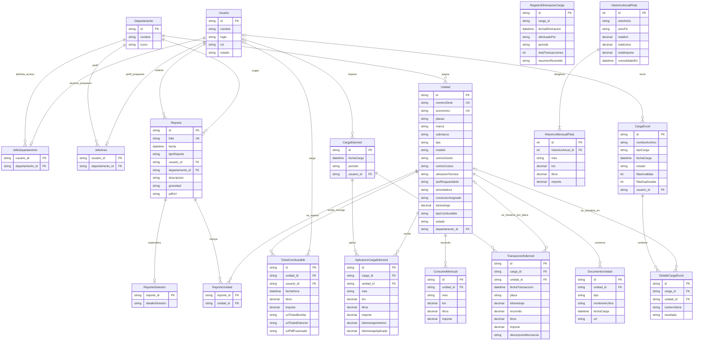
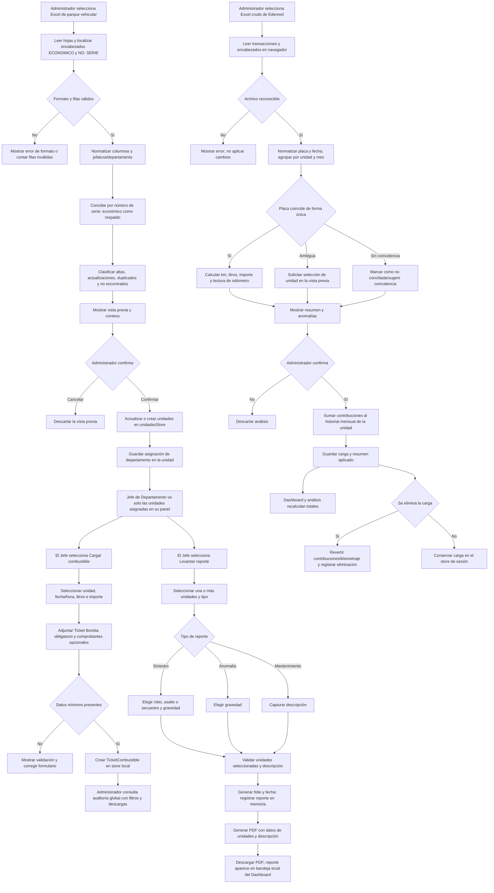

# Documentación del sistema PV-ZTG

> **Estado de esta documentación:** descripción del código presente en el repositorio, revisado el 2 de octubre de 2026. Se distingue entre comportamiento implementado en el frontend y diseño de backend propuesto. Las entidades relacionales del ERD son un modelo lógico objetivo: el proyecto no incluye una base de datos y varias de ellas todavía no existen como tablas.

## 1. Resumen ejecutivo y funcional

### Propósito

PV-ZTG es una aplicación web para la gestión administrativa de la flota vehicular de CFE Transmisión Zona Guerrero. Su interfaz React reúne:

- **Módulo de Flota:** consulta e índice de vehículos, asignación a departamentos, edición de expediente, estado operativo, documentos y carga/actualización del parque vehicular desde Excel.
- **Edenred y combustible:** importación de reportes Edenred, conciliación de transacciones con placas/unidades, cálculo de kilómetros, litros e importe por unidad y mes, revisión antes de aplicar y consulta de tickets de bomba.
- **Carga de tickets:** captura por Jefatura de Departamento de recargas individuales y comprobantes de bomba/Edenred.
- **Reportes de unidades y siniestros:** generación de folios y PDF para anomalías, mantenimiento y siniestros (robo, asalto o secuestro), asociados a una o varias unidades.
- **Dashboard y consultas:** indicadores de flota, bandeja de reportes, análisis de combustible y descargas PDF. La página general de Reportes conserva una previsualización con contenido estático y filtros simulados.

### Arquitectura actual

- **Frontend:** JavaScript/JSX, React 19, React Router 7 y Vite 8. La aplicación se inicia en `src/main.jsx`; `AuthProvider` envuelve las rutas. Las páginas administrativas comparten `AppLayout` y `SearchProvider`.
- **Estado compartido:** stores JavaScript en memoria con suscripción pub/sub y hooks React (`useUnidades`, `useReportes`, `useTicketsCombustible`, etc.). Los stores no persisten al recargar la página.
- **Estado local:** `useState` administra formularios, filtros, paneles, modales, previsualizaciones y estados de carga. `AuthContext` mantiene la sesión y `SearchContext` la búsqueda global del layout administrativo.
- **Lectura y generación de archivos:** `xlsx` analiza archivos Excel en el navegador; `jspdf` crea documentos descargables. Para los archivos adjuntos se crean URL temporales del navegador (`URL.createObjectURL`), no almacenamiento permanente.
- **Backend:** el backend PHP/API todavía no forma parte de este repositorio. El contrato HTTP implementado actualmente cubre autenticación y recuperación de contraseña. Los esquemas y endpoints de combustible e histórico anual bajo `server-design/` son ejemplos de referencia, no servicios desplegados.

### Roles, permisos y pantallas

| Perfil funcional | Acceso y pantallas descritas en el código | Permisos/capacidades funcionales actuales |
|---|---|---|
| **Administrador / Auditor operativo** | Login general `/`; panel administrativo `/dashboard`, `/flota`, `/indice-unidades`, `/auditoria-edenred`, `/analisis-combustible`, `/tickets-combustible`, `/reportes`, `/accesos` y `/perfil`. | Consulta y edición de unidades; importa parque vehicular y Edenred; revisa/aplica conciliaciones; elimina cargas Edenred con rollback y registro local de auditoría; consulta tickets de todos los departamentos; revisa los reportes recibidos; genera descargas PDF. El login general envía el rol `auditor`, aunque varias pantallas y textos llaman a este perfil “Administrador”. |
| **Superadministrador** | Acceso separado `/admin/login`. El formulario intenta navegar a `/admin` después del login. | Tiene una ruta de autenticación separada y aparece en las descripciones de la bandeja de reportes. No hay una pantalla `/admin` registrada actualmente ni reglas de autorización distintas implementadas. |
| **Jefe de Departamento** | Login `/login/jefe-departamento`; panel dedicado `/jefe-departamento`. | Consulta las unidades cuyo `departamento` coincide con el de su sesión; puede cargar una recarga con Ticket Bomba obligatorio, comprobantes complementarios opcionales y levantar reportes formales sobre una o más unidades. Consulta/descarga documentos de la unidad, pero no edita su expediente. |
| **Jefe de Área** | No existe ruta, contexto, tipo de rol ni pantalla propios en el código revisado. | No se pueden atribuir permisos actuales. Debe definirse como requisito futuro antes de documentar o implementar una matriz de autorizaciones para este perfil. |

**Límite de seguridad importante:** las rutas de `App.jsx` no tienen guardas de autenticación/rol. La selección de unidades por departamento es un filtro de interfaz, no un control de acceso en servidor. `AuthContext` tiene habilitado `DEV_BYPASS_AUTH`: si falla el login HTTP, crea una sesión local de prueba con los valores escritos. Por tanto, el código actual sirve para navegación/prototipo, no para aplicar control de acceso de producción.

### Rutas y pantallas

| Ruta | Pantalla/función |
|---|---|
| `/` | Login general (rol enviado: `auditor`). |
| `/recuperar-contrasena` | Solicitud, verificación OTP y restablecimiento. |
| `/admin/login` | Login separado de Superadministrador. |
| `/login/jefe-departamento` | Login con usuario, contraseña y departamento. |
| `/jefe-departamento` | Unidades del departamento, carga de combustible, reportes y documentos. |
| `/dashboard` | Indicadores, acumulados anuales y bandeja de reportes. |
| `/flota`, `/indice-unidades` | Tabla de flota agrupada por departamento e índice de alertas/expedientes. |
| `/auditoria-edenred` | Carga, análisis, resolución de placas ambiguas, confirmación y eliminación con rollback. |
| `/analisis-combustible` | Historial anual de una unidad y exportación PDF. |
| `/tickets-combustible` | Auditoría global de recargas con filtros de unidad/departamento/fecha. |
| `/reportes` | Pantalla de previsualización de reportes; datos y filtros todavía son de demostración. |
| `/accesos` | Directorio estático de ejemplo; botones y toggles no gestionan usuarios reales. |
| `/perfil` | Perfil del usuario. |

La ruta `/admin` no está declarada a pesar de ser el destino del login de Superadministrador. Hay además una página standalone de captura móvil en el repositorio, pero no tiene una ruta configurada en `App.jsx`.

### Datos, stores y estados React

| Store/contexto | Contenido y operaciones principales | Persistencia actual |
|---|---|---|
| `unidadesStore` | Catálogo de unidades inicial desde `unidades.json`; alta/edición/baja lógica, asignación departamental, documentos e historial mensual. Diferencia cambios manuales para que las importaciones no los sobrescriban. | Memoria del navegador; el catálogo semilla se carga desde un JSON incluido en el bundle. |
| `departamentosStore` | Catálogo dinámico de departamentos, altas y resolución de nombre. | Memoria; semilla local de nueve departamentos. Hay también `departamentos.js`, un catálogo estático paralelo. |
| `edenredStore` | Cargas individuales de Edenred con periodo, filas crudas y resumen de contribuciones por unidad/mes. Al eliminar revierte combustible/kilometraje y agrega una entrada al log. | Memoria; el log no es durable pese a que el comentario lo describe como histórico permanente. |
| `combustibleTicketsStore` | Recargas individuales con unidad, fecha/hora, litros, importe, URLs de comprobantes y nombre de quien subió. | Memoria; los adjuntos son URL de objeto temporal. |
| `reportesStore` | Reportes de anomalía, mantenimiento y siniestro; genera identificador, folio y fecha al crear. | Memoria; el PDF es una URL temporal. |
| `historialEliminacionesStore` | Evento de eliminación de carga Edenred, responsable, periodo y resumen revertido. | Memoria de la sesión. |
| `AuthContext` | Usuario, token, rol, rehidratación, login/logout y persistencia opcional del token. | `localStorage` (“recordar sesión”) o `sessionStorage`; no persiste contraseña. |
| `SearchContext` | Texto de búsqueda común del layout administrativo. | Estado React mientras vive el layout. |

Los hooks reactivos de los stores inicializan su estado con el contenido actual y se suscriben a notificaciones del store en `useEffect`. Las páginas calculan agregaciones y filtros con `useMemo`; filtros editables se mantienen en `useState`.

#### Modelo actual de objetos

- **Unidad:** `id` (actualmente VIN/número de serie), `economico`, `marca`, `submarca`, `tipo`, `modelo`, `numeroSerie`, `placas`, `placas2025`, `centroGestor`, `centroCostos`, `ubicacionTecnica`, `rpeResguardante`, `arrendadora`, `conductorAsignado`, `kilometraje`, `tipoCombustible`, `estado`, `imagenUrl`, `documentos[]`, `historialCombustible[]`, `departamento` y, si hubo correcciones del usuario, `camposModificadosManualmente[]`.
- **Registro mensual de combustible:** `mes` (`AAAA-MM`), `km`, `litros`, `importe`; actualmente está anidado en `unidad.historialCombustible`.
- **Carga Edenred:** `id`, `fechaCarga`, `periodo[]`, `transacciones[]`, `resumenAplicado[]`. Cada contribución incluye `unidadId`, mes, km, litros, importe y kilometraje anterior/aplicado para permitir rollback.
- **Ticket de combustible:** `id`, `unidadId`, `fechaHora`, `litros`, `importe`, URLs de ticket bomba/Edenred/PDF fusionado y `subidoPor`.
- **Reporte:** `id`, `folio`, `fecha`, `tipoReporte`, `unidadesIds[]`, `autorNombre`, `autorDepartamento`, `descripcion`, `gravedad`, `detalleSiniestro` y `pdfUrl`. `tipoReporte` es anomalía, mantenimiento o siniestro; la clasificación de siniestro admite robo, asalto o secuestro.
- **Departamento:** `id`, `nombre`, `icono`. La unidad guarda hoy el identificador de departamento en una propiedad string; no hay una FK real hasta la base de datos.

### API y servicios

La URL base usa `VITE_API_BASE_URL` o `/api`. Las funciones HTTP actuales están en `src/services/authService.js`; todas usan `fetch`, envían JSON y devuelven JSON o lanzan un error de aplicación.

| Método | Endpoint | Propósito |
|---|---|---|
| `POST` | `/auth/login` | Login operativo general (credenciales RCF/usuario, contraseña y rol `auditor`). |
| `POST` | `/auth/login-superadmin` | Login separado de Superadministrador. |
| `POST` | `/auth/login-jefe-departamento` | Login de jefatura con departamento seleccionado. |
| `POST` | `/auth/recuperacion/solicitar` | Solicita código OTP por celular o correo. |
| `POST` | `/auth/recuperacion/verificar` | Verifica OTP y recibe token de restablecimiento. |
| `POST` | `/auth/recuperacion/restablecer` | Cambia la contraseña con token de restablecimiento. |

No hay llamadas HTTP desde los stores de unidades, reportes, Edenred, departamentos o tickets. El archivo `server-design/esquema-relacional.js` ilustra endpoints futuros `/api/tickets-combustible`; `server-design/historico-anual.route.js` ilustra consolidación y lectura de histórico. No son rutas activas de la aplicación. `ReportesPage` tampoco consulta datos: su recarga de filtros es un temporizador visual.

## 2. Diagrama entidad-relación

El siguiente diagrama separa entidades que existen como objetos/stores en el cliente y entidades normalizadas propuestas para una base relacional. **No representa tablas ya desplegadas.** Las tablas de asociación y los perfiles de jefatura son necesarios para expresar relaciones que hoy se guardan como arreglos, strings o campos dentro de objetos.

### Notas de interpretación del ERD

1. `JefeDepartamento` es una sesión/rol con departamento elegido en el frontend, pero no existe tabla de usuarios ni de perfiles aún. `JefeArea` es exclusivamente una propuesta para el rol solicitado; no aparece en rutas, stores o servicios. Las propiedades con sufijo `_id` marcadas `FK` representan llaves foráneas conceptuales; en `ReporteUnidad`, ambas llaves son además parte de la llave primaria compuesta.
2. `CargaExcel` y `DetalleCargaExcel` proponen conservar metadatos/resultado de las importaciones. Hoy el Excel del parque vehicular se procesa y confirma localmente sin registrar una entidad de carga ni sus filas procesadas.
3. Edenred registra cada carga de forma separada en memoria (`CargaEdenred`), con transacciones originales y resumen aplicado. `AplicacionCargaEdenred` modela ese resumen para hacer reversible cada contribución. `TransaccionEdenred.unidad_id` puede ser nulo antes de resolver una placa ambigua.
4. La relación Reporte-Unidad es N:M: el reporte acepta varias unidades y una unidad puede acumular múltiples reportes. Actualmente se representa con `unidadesIds[]`, no con una tabla de unión.
5. `ReporteSiniestro` expresa conceptualmente los campos específicos del tipo siniestro; hoy `detalleSiniestro` vive en el mismo objeto `Reporte`.
6. Los tickets actuales guardan `subidoPor` como nombre, mientras que el SQL de referencia propone `subido_por` como FK de usuario. La migración deberá acordar una llave estable.
7. La referencia de histórico anual propone tablas de agregado global y sus 12 meses; no existe ejecución/persistencia de esta consolidación en la app.

## 3. Diagrama del flujo principal

El diagrama refleja la carga de parque vehicular, la asignación de departamento, la conciliación Edenred, la captura de tickets y el ciclo de reporte de siniestro. Los datos se conservan en stores de navegador hasta implementar backend y persistencia.

## Consideraciones operativas y pendientes

- Stores y URLs blob se pierden al cerrar/recargar el navegador; tickets, archivos y reportes no están respaldados permanentemente.
- Los links y textos de algunas pantallas afirman envío a “todas las cuentas” o persistencia histórica, pero actualmente las notificaciones son locales a la instancia React.
- Debe implementarse backend con autorización por rol/departamento y persistencia de archivos antes de tratar datos o reportes como compartidos entre usuarios.
- La importación del parque vehicular aplica actualizaciones en memoria tras confirmación. Los campos modificados manualmente se excluyen de la importación automática; las altas se identifican por VIN y el número económico también evita duplicados.
- El consumo mensual proveniente de Edenred se agrega por mes; el editor manual de historial reemplaza el valor de ese mes. El borrado de una carga revierte lo registrado en su resumen aplicado.
- Los nombres de rol y rutas deben alinearse: en código conviven “Administrador”, “Auditor” y “Superadministrador”; el login operativo usa `auditor`, y el perfil de Jefe de Área aún no está definido.
